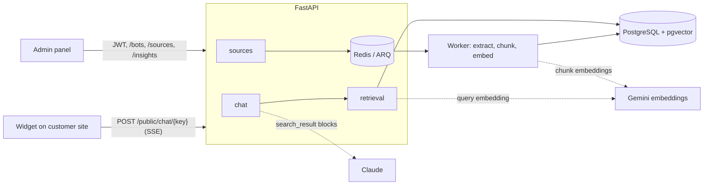

# RAGDesk API

[](https://github.com/jesus1244/ragdesk-api/actions/workflows/ci.yml)


Chat with your own documents. A business uploads PDFs, Markdown, text or web pages, drops one
`<script>` tag on its site, and visitors get answers that **stream in real time and cite the exact
passages they came from**. Questions the assistant cannot answer are collected so the owner knows
what documentation is missing.

This repository is the backend. The admin panel and the embeddable widget live in `ragdesk-web`.

## Features

- **Ingestion**: PDF (per page), Markdown (split by heading), plain text and URLs. Runs in a
  background job, is idempotent and retries provider failures.
- **Hybrid retrieval**: pgvector (HNSW, cosine) plus PostgreSQL full-text search, fused with
  Reciprocal Rank Fusion and cut by a maximum distance so unrelated questions retrieve nothing.
- **Cited answers**: passages are sent to Claude as `search_result` blocks with native citations,
  so every citation points at a passage that was really retrieved. Nothing is parsed out of text.
- **Streaming**: the public chat endpoint answers over Server-Sent Events.
- **Unanswered questions**: an answer with no citation is recorded as unanswered. Owners get a list,
  conversation history and answer-rate stats.
- **Multi-tenant**: every query is scoped by bot; another owner's resource is a 404.
- **Demo mode**: one command creates a ready-to-chat assistant with sample documents.
- **Offline by default**: with `EMBEDDER=fake` and `CHAT_MODEL_PROVIDER=fake` nothing leaves your
  machine and no API keys are needed.

## Architecture



Answering a question:

1. Validate the bot key and the `Origin` against the bot's allowed-origins list, then rate limit.
2. Embed the question (Gemini) and run the vector and full-text queries in the bot's scope.
3. Fuse both rankings with RRF and drop anything farther than `RETRIEVAL_MAX_DISTANCE`.
4. If nothing is left, answer "not found" **without calling Claude** and record it as unanswered.
5. Otherwise send the passages as `search_result` blocks, stream the text, and collect citations.
6. Store both messages, the citations and the `answered` flag.

SSE events: `meta` (conversation id), `delta` (text, many), `citations`, `done` (`answered`), and
`error` instead of the last two when something fails. Errors never include provider details.

## Stack and why

| Concern | Choice |
|---|---|
| Web | FastAPI with native SSE |
| Data | PostgreSQL 18 + pgvector, SQLAlchemy 2 async, Alembic |
| Embeddings | Gemini `gemini-embedding-2`, 768 dimensions |
| Generation | Claude `claude-opus-5-5`, effort `low`, refusal fallbacks enabled |
| Jobs | ARQ on Redis with deterministic job ids |
| Tooling | uv, ruff, mypy strict, pytest, testcontainers |

One database for vectors and relational data keeps tenant deletes transactional and removes a
second system to run. The reasons, rejected alternatives and sources for every choice are in
[`docs/technology-decisions.md`](docs/technology-decisions.md).

## Quickstart

Requires Docker and [uv](https://docs.astral.sh/uv/).

```bash
cp .env.example .env
docker compose up -d postgres redis
uv sync --locked
uv run alembic upgrade head
uv run fastapi dev src/ragdesk/main.py          # API at http://localhost:8000/docs
uv run arq ragdesk.worker.WorkerSettings        # in a second terminal
uv run ragdesk-seed-demo                        # demo assistant + prints its widget key
```

Try the demo assistant:

```bash
curl -N -X POST http://localhost:8000/api/v1/public/chat/<widget-key> \
  -H 'Content-Type: application/json' \
  -d '{"question": "How long do I have to return an item?"}'
```

The seed creates an English and a Spanish demo assistant (separate widget keys). An assistant has a
`language`, a `fallback_message` and up to four `suggested_questions`; the public widget config
returns the language and the suggestions.

Two faces, two addresses (details in [ragdesk-web](https://github.com/jesus1244/ragdesk-web#try-it-end-to-end-two-different-places)):
the owner's panel at `http://localhost:4200` and the visitor's chat at
`http://localhost:4200/widget-demo.html?bot=<widget-key>`. The seed prints the demo login and the key.

To use the real providers set `EMBEDDER=gemini`, `GEMINI_API_KEY`, `CHAT_MODEL_PROVIDER=claude` and
`ANTHROPIC_API_KEY` in `.env`. Or run everything in containers: `docker compose --profile app up`.

## Configuration

Every variable is documented in [`.env.example`](.env.example) and validated in
`src/ragdesk/core/config.py`. In `staging` and `production` the app **refuses to start** with a
weak `JWT_SECRET`, a missing provider key, or private-host URL fetching enabled. Interactive docs
are disabled there.

## API overview

All routes are under `/api/v1`, except health checks. Lists are paginated (`limit` up to 100, `offset`).

| Area | Routes |
|---|---|
| Auth | `POST /auth/register`, `/auth/login`, `/auth/refresh`, `/auth/logout`, `GET /auth/me` |
| Bots | `GET/POST /bots`, `GET/PATCH/DELETE /bots/{id}` |
| Sources | `GET /bots/{id}/sources`, `POST .../sources/file`, `/url`, `/text`, `POST .../{sid}/retry`, `DELETE .../{sid}` |
| Insights | `GET /bots/{id}/stats`, `/conversations`, `/conversations/{cid}/messages`, `/unanswered` |
| Public (widget) | `GET /public/bots/{key}`, `POST /public/chat/{key}` (SSE) |
| Health | `GET /health/live`, `/health/ready` |

## Security notes

- Passwords use Argon2id; login timing is constant and the error is the same for unknown users.
  Refresh tokens rotate, and reuse of an old one revokes the whole family.
- The public endpoint is keyed by an unguessable bot key plus an allowed-origins list, answers
  only questions, and is rate limited. CORS on `/public/*` never allows credentials.
- Retrieved text is treated as data: the system prompt tells the model documents are never
  instructions, and the document text is never placed in the system prompt.
- URL ingestion goes through an SSRF guard: http(s) on ports 80/443 only, every resolved address
  must be public, redirects are followed manually and re-validated, and size, time and content-type
  are capped.
- **Known limitation:** the guard resolves the hostname before connecting, so a DNS-rebinding
  attacker could still race the check. In production, add an egress firewall that blocks private
  ranges for the worker.
- Logs carry ids, sizes and durations, never document text, tokens or full questions.

## Testing

```bash
uv run ruff check . && uv run ruff format --check . && uv run mypy
uv run pytest --cov
```

Tests run against a **real PostgreSQL with pgvector** started by testcontainers (or the database
in `TEST_DATABASE_URL`), and the schema is built by running the Alembic migrations, so migrations
are tested too. Claude, Gemini and Redis are replaced by in-memory doubles; no test calls a paid
API. Coverage gate: 85% (currently about 95%). CI runs lint, types, tests, a migration drift
check with a downgrade round trip, and a Docker build.

## Engineering standards

The repository follows written rules so that people and coding agents behave the same way:

- [`AGENTS.md`](AGENTS.md) holds the short, always-on rules.
- Per-topic rules (Python style, routes, data, RAG pipeline, security, testing, git workflow) are
  generated from one source, `scripts/gen_steering.py`, into `.claude/rules/`,
  `.github/instructions/` and `.kiro/steering/`, so Claude Code, Copilot and Kiro read the same
  guidance. Edit the script, then run `uv run python scripts/gen_steering.py`.
- Small commits, one feature each, with tests in the same commit. See `git log` for the
  build-up of the project, from bootstrap to chat.

## Project layout

```
src/ragdesk/
  core/        settings, database, security, errors, logging, queue, rate limit, CORS
  auth/        users and JWT
  bots/        a knowledge base and its widget settings
  sources/     documents and URLs, and their chunks
  ingestion/   extract, chunk, embed (ARQ job)
  retrieval/   hybrid search
  chat/        public chat, Claude client, conversations
  insights/    conversations, unanswered questions, stats
  demo/        sample assistant seed
migrations/    Alembic
tests/         mirrors src/
```

## License

MIT
